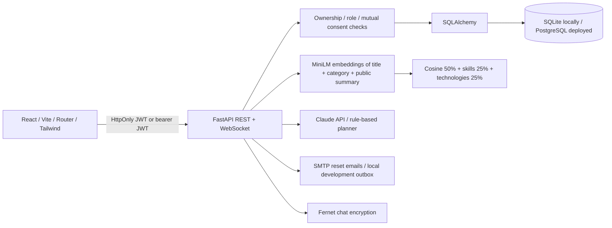

# AI Idea Merger

A complete React + FastAPI engineering project for finding collaborators by the meaning of their ideas, with explicit consent before private details unlock.

## Login flow

The Sign in link is available on desktop and mobile. It opens `/login` even if another session already exists; that screen offers Continue to workspace or lets you sign in again. A normal successful login opens the dashboard. Opening a protected page while signed out returns you to that page after login. Sessions persist on refresh, and logout returns to the login screen.

Use the same origin throughout (for example, `http://127.0.0.1:5173`); do not alternate between localhost and 127.0.0.1, because cookies belong to the chosen host. If the website is offline, launch START-WEBSITE.cmd and keep its terminal open. If Sign in reports an error, it stays on the form with an explanatory message.

## New: idea merging

Inspired by the workflow in [Ideanote's AI Merge Ideas update](https://ideanote.io/updates/ai-merge-ideas), this version includes a complete **Merge ideas** studio. Select 2–5 of your own active ideas, generate an editable combined draft, review every field, and save it as a new idea. Originals are never deleted or overwritten. The source record remains in the private description; skills and technologies are combined, and the strictest source privacy is retained. Ideas from different categories default to Other for your review.

The default **local structured merger** runs without an API key. Optional Claude synthesis uses only public source abstracts; private descriptions are combined on the server. The engine is labeled honestly in the interface. Generation is non-destructive, and nothing is saved until you confirm. You cannot merge someone else's idea merely because they shared it with you.

Demo: sign in as Alex and open **Merge ideas**. Select **GrowSense** and **HarvestLink**, generate a draft, edit it, and save. The seed now contains six ideas across five members so this workflow works on first run.

## Use it online, outside ChatGPT

The full application now supports a single public host serving both the built React frontend and the Python API. See [PUBLIC_WEBSITE.md](docs/PUBLIC_WEBSITE.md). `Dockerfile.public` builds both parts and caches MiniLM; `render.yaml` connects the app to persistent PostgreSQL and generates security keys. Public login hides demo credentials, and public deployment does not seed known demo accounts.

**No public URL has been provisioned yet.** A compatible hosting account must be connected, the source repository supplied, and any hosting charges approved before deployment. A localhost link is not a public website.

## Run on Windows

Requires Python 3.10+ and Node.js 22+; internet is needed for first-time dependencies and the MiniLM model download. Open PowerShell **inside this folder**:

```powershell
powershell -ExecutionPolicy Bypass -File .\start.ps1
```

You can also double-click `START-WEBSITE.cmd`. The launcher creates `.venv`, installs dependencies, migrates SQLite, seeds six accounts and six ideas, and runs both servers. It checks occupied ports and API readiness and reports startup failures clearly. The first run downloads PyTorch and MiniLM and can take several minutes. Subsequent runs can use:

```powershell
.\start.ps1 -SkipInstall
```

Open **http://127.0.0.1:5173**. Keep the terminal open. Ctrl+C stops the app. If scripts are blocked, see [manual Windows setup](docs/SETUP.md).

| Demo account | Email | Password |
| --- | --- | --- |
| Main member | alex@ideamerger.demo | BuildTogether!2026 |
| Priya | priya@ideamerger.demo | BuildTogether!2026 |
| Daniel | daniel@ideamerger.demo | BuildTogether!2026 |
| Sofia | sofia@ideamerger.demo | BuildTogether!2026 |
| Arjun | arjun@ideamerger.demo | BuildTogether!2026 |
| Administrator | admin@ideamerger.demo | BuildTogether!2026 |

Only seed disposable development/demo databases. Set `DEMO_PASSWORD` **before** the first seed to change the demo password. Existing accounts are preserved on subsequent seeds. The shipped source/archive excludes databases and secrets.

## Features

- All 15 requested pages, an additional merge studio, Terms & Conditions, forgotten/reset password, and notification bell.
- React Router, Tailwind build pipeline, custom responsive light/dark design, visible keyboard focus, validated forms, and loading/empty/error states.
- JWT with eight-hour expiry, HttpOnly cookies for browser sessions and bearer tokens for API clients, bcrypt, session revocation, role checks, origin checks, and persistent login throttling.
- Public-summary Sentence-BERT matching: 50% cosine similarity + 25% skill fit + 25% technology Jaccard overlap. Private descriptions are never embedded.
- Three privacy levels and per-idea, per-collaborator mutual consent enforced by the API. Hidden idea component scores are withheld to reduce metadata probing.
- Sent/received invitations, server-authorized projects, shared private descriptions, milestones, and progress.
- Fernet-encrypted chat at rest; REST polling every 2.5 seconds in the UI plus an authenticated WebSocket endpoint.
- Claude project planning from public summaries, with an automatic rule-based fallback when no key is configured or the API fails.
- Profile discovery controls, notification preferences, mandatory consent, reports, account suspension/reinstatement, moderation, and statistics.
- Required versioned terms acceptance, authorship submission timestamps, user watermarks, focus curtain, copy/drag/print deterrents.
- SQLite development, PostgreSQL configuration, Alembic migrations, Docker Compose, API examples, and automated tests.

## Architecture



The browser never decides access to private descriptions: `idea_json`, `consented`, and `project_access` enforce it centrally. Sending an invitation records the sender's consent; recipient acceptance must include explicit consent. Accepted projects retain idea history, so an idea in an accepted collaboration can be archived but cannot be hard-deleted through ordinary CRUD.

## Folder structure

```text
ai-idea-merger/
  backend/
    app/
      main.py                 REST, WebSocket, authorization and schemas
      models.py               SQLAlchemy tables and database configuration
      security.py             JWT, bcrypt, encryption, rate limits
      matching.py             MiniLM encoder and compatibility calculation
      merging.py              Ownership-safe synthesis and field preservation
      seed.py                 Administrator, five users, five ideas, invitation
    migrations/               Alembic initial schema and revision template
    tests/test_app.py          Matching, consent, auth, chat and isolation tests
    alembic.ini
    requirements.txt          Core runtime and testing dependencies
    requirements-ai.txt       Core + sentence-transformers
  frontend/
    src/main.jsx              React application and shared components
    src/MergeIdeas.jsx         Selection, review, edit, and save merge workflow
    src/styles.css            Responsive design system and protection styles
    index.html
    package.json
    package-lock.json
    vite.config.js
    tailwind.config.js
    postcss.config.js
    vercel.json
  docs/
    API.md                    Every REST endpoint, examples, WebSocket protocol
    openapi.json              Machine-readable API contract
    DATABASE.md               ER diagram and migration instructions
    SETUP.md                  Windows setup and troubleshooting
    DEPLOYMENT.md             Docker, Render, Vercel and production configuration
    PROJECT_REPORT.md         Final-year report outline and evaluation plan
    VERIFICATION.md           Actual test results and known operational limits
    screenshots/              Captured browser previews
  .env.example
  .gitignore
  .dockerignore
  Dockerfile
  frontend.Dockerfile
  docker-compose.yml
  nginx.conf
  start.ps1
  START-WEBSITE.cmd
```

## Tests and build

From the project folder after installing dependencies:

```powershell
.\.venv\Scripts\python.exe -m pytest backend/tests -q
npm --prefix frontend test
npm --prefix frontend run build
```

Tests use a deterministic hashing encoder and isolated in-memory SQLite, avoiding network/model downloads; the running demo uses the real MiniLM encoder. See [verification](docs/VERIFICATION.md) for the checks actually performed.

API docs: **http://127.0.0.1:8000/docs**. Endpoint examples: [API guide](docs/API.md). Database: [ER design](docs/DATABASE.md). Deployment: [deployment guide](docs/DEPLOYMENT.md). Report: [project report](docs/PROJECT_REPORT.md).

## Screenshots


Screenshots contain fictional seeded account data. Additional desktop/mobile captures are in `docs/screenshots`.

## Operating boundaries

This is a working application ready for local use and deployment configuration. Public launch still needs a hosting account, production secrets, HTTPS, SMTP credentials for delivered reset emails, backups, and an operational review. Docker and paid external services are not provisioned automatically.

Browsers cannot reliably block screenshots, OS shortcuts, cameras, developer tools, or determined scraping. The protection controls are deterrents combined with consent, legal terms, and traceable watermarks. Authorship timestamps are server records, not a legal proof of originality or a notarization. Moderation removes ideas from discovery by archiving; existing shared project history is retained.

For public-scale traffic, move rate limiting to an atomic shared store, paginate collections, precompute/vector-index matches, add security audit logging and monitoring, and use a transactional email service. The current matcher intentionally keeps the final-year algorithm readable and operates on the available candidate set.
